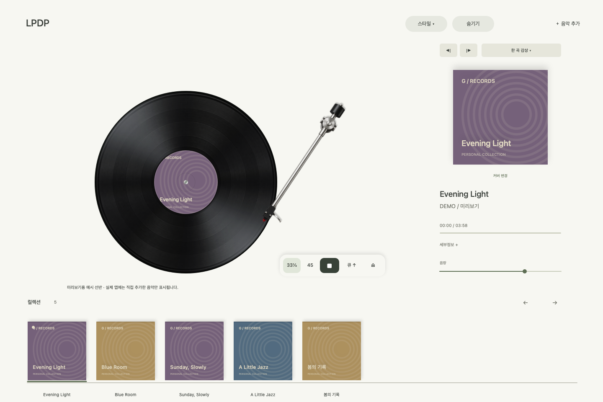

# LPDP

내 음악을 한 장씩 꺼내 듣는 macOS용 LP 플레이어. Swift와 AppKit으로 만든 네이티브 앱입니다.



## 다운로드

[최신 릴리스](https://github.com/kimdham-design/LPDP/releases/latest)에서 **LPDP-5.6-macOS-arm64.zip**을 내려받아 압축을 풀고 `LPDP.app`을 응용 프로그램 폴더로 옮겨 실행하세요.

- Apple Silicon Mac (M1 이상), macOS 14 이상을 대상으로 빌드합니다.
- 실행 검증 환경: macOS 27 / Apple Silicon. 이전 macOS 버전에서의 실행 검증은 아직 하지 않았습니다.
- 개인 개발 버전으로 Apple Developer ID 서명 및 공증은 하지 않았습니다. macOS가 실행을 차단할 수 있습니다. 신뢰할 수 있는 이 저장소의 릴리스인지 확인하고 macOS의 시스템 설정 → 개인정보 보호 및 보안에서 실행 여부를 결정하세요.
- Intel Mac, 스트리밍 서비스, DRM 음원은 지원하지 않습니다.

## 기능

- 앨범 슬리브에서 LP를 꺼내 플레이어에 놓는 드래그 조작
- 연속 회전, 가속·관성 정지, 재생 시간에 맞춰 움직이는 톤암
- 실시간 LP 반사와 33⅓ / 45 RPM, 피치 조절
- 미니멀·클래식 플레이어와 우드·스톤·딥 블루·앨범 아트 블러 배경
- 파일 메타데이터, 앨범 커버 변경, 개인 음반 선반
- 이전·다음 곡, 한 곡 감상·연속·반복·셔플
- 재생 막대 탐색, 음반 파일 재연결, 선반 제거·복원

음악 파일은 포함되어 있지 않습니다. 본인의 로컬 오디오 파일을 추가하세요. 미리보기의 음반 제목과 커버는 데모입니다. 라이브러리 정보는 로컬 Application Support/GrooveListeningRoom에 저장됩니다. 원본 파일은 이동하거나 복사하지 않습니다.

## 소스에서 빌드

Xcode Command Line Tools와 Swift 컴파일러가 설치된 Apple Silicon Mac에서:

```sh
zsh build.command
open .build/LPDP.app
```

전체 로컬 동작 검증과 미리보기 생성:

```sh
zsh test.command
```

`main.swift`는 앱 및 자체 테스트, 루트의 PNG 파일은 이미지 리소스입니다. 별도 패키지 의존성이나 서버는 없습니다. 이미지 리소스는 AI 이미지 생성 도구로 제작했습니다.

[한국어 사용 설명](usage.ko.md)

## 단축키

| 키 | 동작 |
| --- | --- |
| Space | 재생 / 모터 정지 |
| ← / → | 5초 탐색 |
| Option + ← / → | 이전 / 다음 곡 |
| ⌘O | 음악 추가 |
| ⌘U | 톤암 올리기 / 내리기 |
| ⌘E | 음반 꺼내기 |
| ⌘F | 플레이어만 보기 |
| ⌘Z | 마지막 음반 제거 복원 |

## 이용 조건

현재 별도의 오픈소스 라이선스는 지정하지 않았습니다. 공개 저장소라는 사실만으로 재배포·수정에 대한 별도 라이선스를 부여하지는 않습니다.
